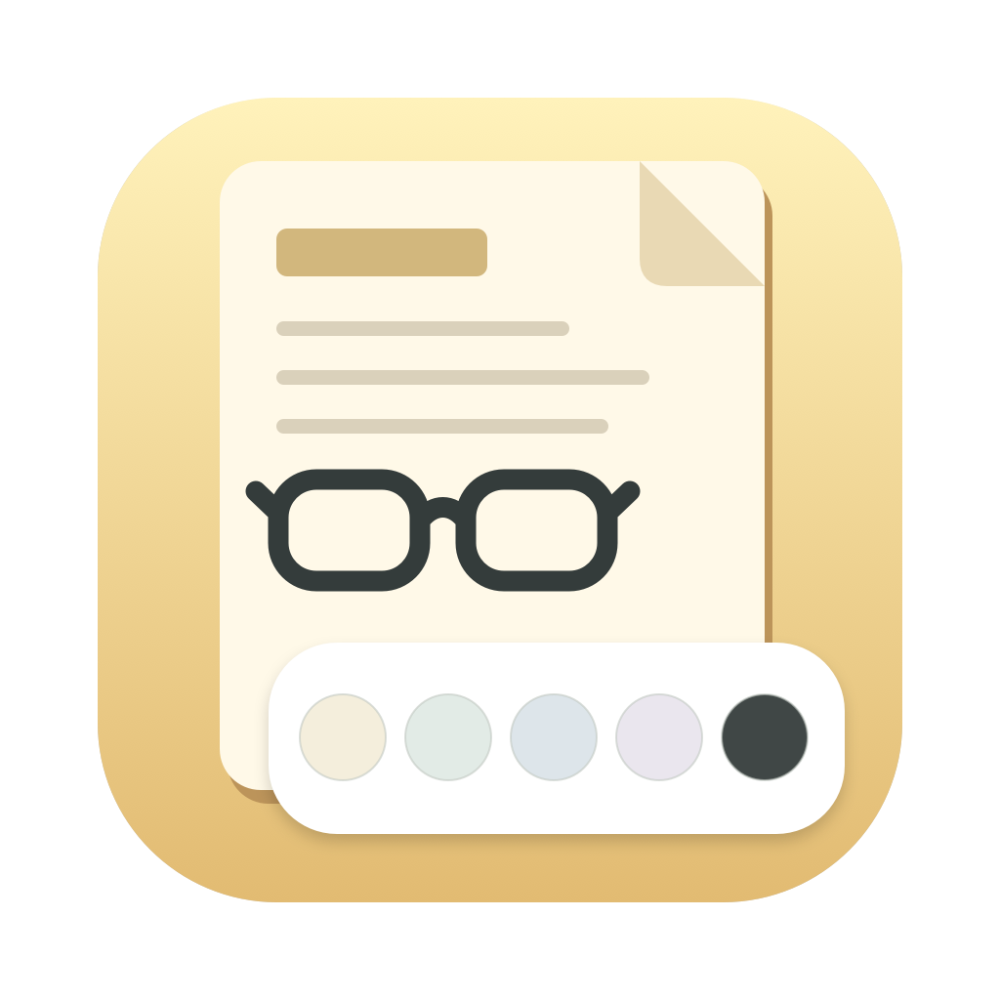

# Colores para Skim



Aplicación sencilla para macOS que cambia el tono de las páginas en **Skim oficial** con un clic. Incluye 18 tonos claros, dos grises oscuros y un botón para volver al blanco original.

## Descargar y usar

1. Descarga `Colores_para_Skim.zip` en [Releases](https://github.com/diegonavarro-84/colores-para-skim/releases/latest).
2. Descomprímelo y abre **Colores para Skim.app**. Puedes arrastrarla a Aplicaciones o al Dock.
3. Pulsa un color. El selector pide a Skim que se cierre normalmente, aplica el ajuste y vuelve a abrirlo. Si Skim solicita guardar cambios, responde a ese aviso. Nunca fuerza el cierre.

La aplicación se distribuye con firma local, sin notarización de Apple. Si macOS bloquea su apertura, revisa el aviso en Ajustes del Sistema > Privacidad y seguridad. También puedes compilarla desde este código.

## Requisitos

- macOS 12 o posterior.
- Skim oficial 1.6.17 o posterior para los tonos claros.
- Skim 1.7.16 o posterior y apariencia Oscuro de macOS para los tonos oscuros.
- El ZIP de la versión 1.0.1 está preparado para Mac con Apple Silicon. La compilación local genera un ejecutable para la arquitectura del Mac que la realiza.

No requiere Terminal para su uso, conexión a Internet, Python ni permisos de administrador. Para compilar se necesitan las herramientas de línea de comandos de Xcode y Python 3.

## Tonalidades

| Tono | HEX |
| --- | --- |
| Crema, recomendado como punto de partida | `#F4EEDC` |
| Blanco suavizado | `#F7F7F2` |
| Crema cálido | `#EFE2C6` |
| Gris claro | `#EEEEEE` |
| Gris cálido | `#E9E6DF` |
| Gris neutro | `#DEDEDE` |
| Papel marfil | `#FAF3E3` |
| Pergamino suave | `#F2E8CF` |
| Arena clara | `#EDE3D1` |
| Avena | `#E7DFCF` |
| Piedra | `#DDD9D0` |
| Champiñón | `#DCD5C9` |
| Salvia muy clara | `#E8EEDF` |
| Verde niebla | `#E2EBE6` |
| Azul bruma | `#E7EDF1` |
| Azul grisáceo | `#DDE5EA` |
| Lavanda grisácea | `#EAE6EE` |
| Rosa empolvado | `#F0E5E1` |
| Oscuro suave | `#303030` |
| Oscuro más claro | `#404040` |
| Blanco original | `#FFFFFF` |

El crema es una sugerencia práctica de comodidad, no un color demostrado como superior para todas las personas. Los HEX son objetivos nominales sobre el blanco; el resultado depende del documento y de la pantalla.

## Qué modifica

Utiliza `defaults` sobre `net.sourceforge.skim-app.skim` y cambia únicamente `SKWhitePoint`, `SKSepiaTone`, `SKInvertColorsInDarkMode` y `SKInvertedColorsBackgroundWhite`.

Los tonos claros desactivan la inversión. Los oscuros la activan. Se desactiva sepia para evitar mezclar efectos. No cambia la apariencia general de macOS ni reescribe los PDF.

**Blanco original** retira el punto blanco y el objetivo oscuro personalizados y desactiva inversión y sepia. No restaura una configuración personalizada anterior al uso del selector.

Los filtros pueden alterar imágenes, resaltados y gráficos. Un escaneo con sombras o un fondo propio no tiene por qué coincidir con la muestra. Si se cancela el cierre de Skim, no se cambian preferencias mientras siga abierto; el selector abandona la espera a los dos minutos. Si falla un comando, el cambio puede quedar incompleto y se muestra el error.

## Compilar

```sh
./build.sh
```

Genera la aplicación y el ZIP en `dist/`. Para ejecutar la comprobación sin modificar preferencias:

```sh
"dist/Colores para Skim.app/Contents/MacOS/ColoresSkim" --check
```

El icono está incluido en `Contents/Resources/AppIcon.icns` y declarado en `Info.plist`; se conserva al descomprimir el ZIP. Su diseño es propio y no utiliza el icono oficial de Skim. El original se puede regenerar con `swift tools/generate-icon.swift`.

La compilación y firma se realizan primero en una carpeta temporal para evitar que los metadatos añadidos por servicios de sincronización interfieran con la firma local.

## Verificación y fuentes

Se han comprobado los planes de cambios de los 21 botones, los valores RGB, la restauración y la ventana de selección. La comprobación no aplica cambios a una instalación de Skim. Las claves se contrastaron con Skim 1.7.17 y la documentación del proyecto el 17/10/2026.

- [Preferencias ocultas de Skim](https://sourceforge.net/p/skim-app/wiki/Hidden_Preferences/)
- [Notas de versión oficiales](https://skim-app.sourceforge.io/relnotes.html)

Proyecto independiente; no está afiliado al proyecto Skim.
